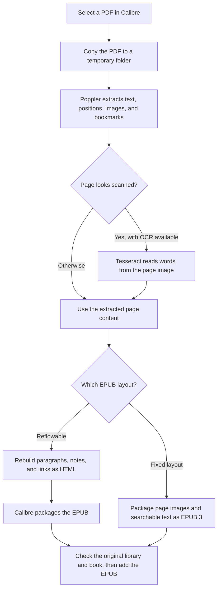

# How the plugin works

A PDF records where things sit on a page. A reflowable EPUB stores text in reading order so an e-reader can wrap the words to fit its screen. A fixed-layout EPUB keeps each page as an image and adds a searchable text layer when text is available.

## Follow one conversion

1. `PDFToEPUBAction.convert_selected()` in `ui.py` reads the selected book and your settings. It starts a background job so Calibre stays responsive. The job copies the PDF to a temporary folder.
2. `convert()` in `xml2html.py` asks Poppler to extract content. Poppler writes XML, a text format with named tags. The plugin turns that data into Python objects. A `Doc` holds `Page` objects, and each page holds `Item` objects for text or images. Each item has coordinates such as `top` and `left`.
3. A scanned page may have an image of text with very few readable characters. `ocr_pages()` renders the page and asks Tesseract to read words and their positions. OCR stands for optical character recognition. If OCR is unavailable or finds no text, the plugin keeps the image.
4. For reflowable output, the converter uses positions, spacing, and font sizes to work out which words belong on a line and which lines belong together. It rebuilds paragraphs, footnotes, and links. Calibre's `Plumber` packages the resulting HTML, styles, and images. For fixed layout, `write_fixed_epub()` uses a picture of each page and puts a transparent text layer over it.
5. `PDFToEPUBAction._done()` checks the library and book before importing the finished EPUB. It respects the replacement setting and removes the temporary files.

## Find the code

| File | What it does |
| --- | --- |
| [__init__.py](../__init__.py) | Tells Calibre the plugin's name, version, and toolbar entry point. |
| [config.py](../config.py) | Defines the settings and the About button. |
| [ui.py](../ui.py) | Connects the toolbar action, background job, and Calibre library. |
| [xml2html.py](../xml2html.py) | Reads PDF content, runs OCR when needed, and rebuilds the book for reflowable output. |
| [fixed_epub.py](../fixed_epub.py) | Packages the whole-page images and text layer into an EPUB 3 file. |

Reflowable conversion uses clues in the original PDF. For example, a large gap between two groups of text can indicate two columns. It can also be part of a table. Fixed layout preserves the appearance in either case. OCR is applied to scans that cover most of a page. Small images embedded in a page of selectable text keep their image content.
